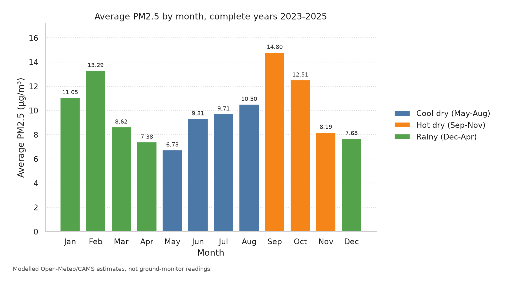
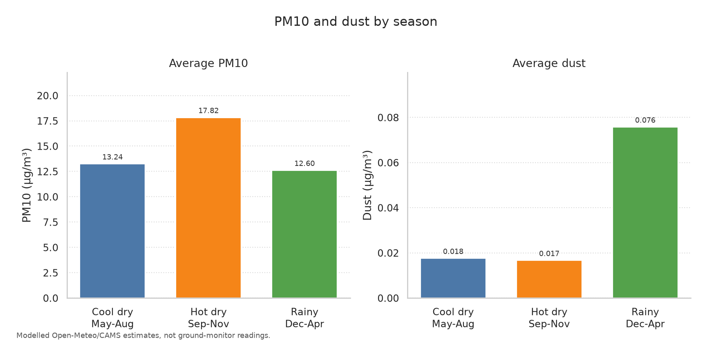
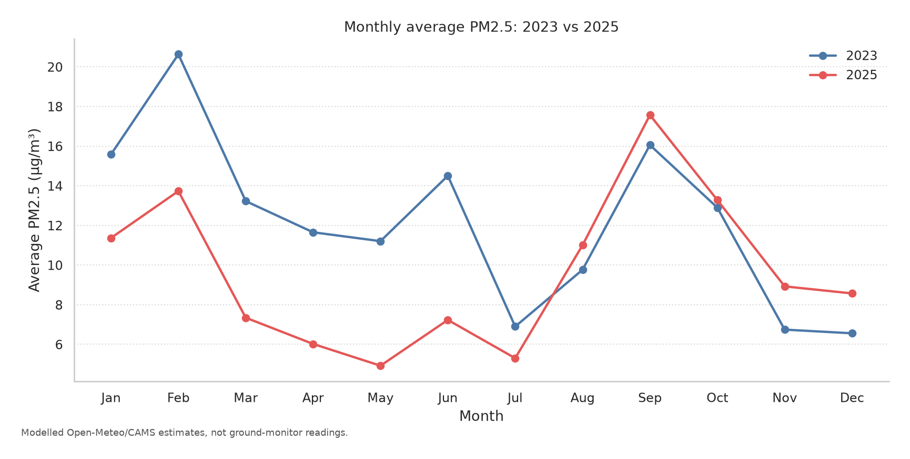

# Lusaka Air Quality Analysis

A beginner data-analyst portfolio project by **Dennis Kabaso**, a computer science student in Lusaka. One Jupyter notebook answers six plain questions about daily air quality in the city with pandas, matplotlib, and seaborn.

The series runs from **1 August 2022 to 18 February 2026** (1,298 daily rows). It describes Lusaka (`latitude -15.40669`, `longitude 28.28713`, GeoNames population 2,212,301).

**These values are modelled estimates from the Open-Meteo Air Quality API (CAMS global). They are not measurements from ground monitors in Lusaka, and they are not an official health or regulatory report.**

## Questions

1. What is the average PM2.5 by month and by season?
2. Which months have the worst air?
3. How many days reach US AQI "Unhealthy" (above 150) or "Unhealthy for sensitive groups" (101-150), by year?
4. Do dust and PM10 rise in the dry season?
5. How strongly are the pollutants correlated?
6. Is the air getting better or worse from 2023 to 2025? Full years only.

Seasons follow the Zambian calendar used in the notebook: **cool dry** May-August, **hot dry** September-November, and **rainy** December-April. The dry season in question 4 is May-November (cool dry plus hot dry).

## Key findings

Numbers below are copied from the executed notebook.

**Hot dry months are the most polluted part of the year.** Across every day with a PM2.5 value, October averages **15.24 µg/m³** and May averages **6.73 µg/m³**. Season averages are cool dry **9.63**, hot dry **13.25**, and rainy **9.93 µg/m³**.

That all-file October figure is pulled up by one month. The worst single month with at least 28 days is **October 2022**, at **23.46 µg/m³** PM2.5 and an average US AQI of **77.32**. On the three complete years only (2023-2025), the highest months are **September 14.80**, **February 13.29**, and **October 12.51 µg/m³**.



**No day in this file reaches US AQI "Unhealthy".** Days with US AQI above 150: **0**. The highest value is **121.08** on **15 August 2022**. Days from 101 to 150: **4** (2022: 2, 2023: 1, 2024: 0, 2025: 1, 2026: 0), on 2022-08-15 (121.08), 2022-10-04 (110.00), 2025-09-06 (105.79), and 2023-02-14 (102.25). Three further days sit above 100 and below 101, so they are outside that band.

**PM10 is higher in the dry season. Dust in this file is not.** Mean PM10 is **15.43 µg/m³** in the dry season and **12.60 µg/m³** in the rainy season, **22.4%** higher in the dry season. The hot dry season is the highest of the three at **17.82 µg/m³**. Mean dust is **0.017 µg/m³** in the dry season and **0.076 µg/m³** in the rainy season. The median dust is **0** in every season. Dust is above zero on **94 of 1,295** days (2022: 0, 2023: 3, 2024: 7, 2025: 67, 2026: 17). The same direction shows up on 2023-2025 alone: mean PM10 **13.59** vs **12.29 µg/m³**, mean dust **0.020** vs **0.063 µg/m³**.



**PM2.5 and PM10 move together.** The strongest Pearson correlation is PM2.5 with PM10 (**0.97**). Next is CO with NO2 (**0.93**). The most negative pair is NO2 with ozone (**-0.23**). Dust's strongest link is with SO2 (**0.19**). US AQI and PM2.5 correlate at **0.92**; the index is left off the heatmap because it is built from the pollutant columns.

**2025 is cleaner than 2023 on the annual averages, and the improvement is not in every month.** Mean PM2.5 moved from **12.07 µg/m³** in 2023 to **9.57 µg/m³** in 2025 (**20.7%** lower). Mean US AQI moved from **47.40** to **42.42** (**10.5%** lower). Mean PM10 moved from **17.55** to **9.99 µg/m³** (**43.1%** lower). January through July were lower in 2025 (**7 of 12** months). August through December were higher (**5 of 12**). 2024, the other full year, averaged **8.23 µg/m³** PM2.5, so 2025 is cleaner than 2023 and higher than 2024. Days with PM2.5 above the WHO 2021 24-hour guideline of 15 µg/m³ fell from **102** to **59**. Both annual means are above the WHO 2021 annual guideline of **5 µg/m³**.



## How to run

Python 3.11 or newer. The notebook was executed with Python 3.12 and the pinned packages in `requirements.txt`.

```bash
python3 -m venv .venv
source .venv/bin/activate
pip install -r requirements.txt
jupyter notebook notebooks/lusaka_air_quality_analysis.ipynb
```

The notebook looks for `data/raw/` from the project folder, whether the kernel starts in the repo root or in `notebooks/`. It writes the charts to `images/`.

To execute it from the command line and refresh the saved outputs:

```bash
jupyter nbconvert --to notebook --execute notebooks/lusaka_air_quality_analysis.ipynb --inplace
```

## Data

The three files in `data/raw/` come from Zenodo record [18680531](https://zenodo.org/records/18680531):

- `air_quality_historical.csv` — daily pollutants, US AQI, European AQI, dust, and related columns
- `data_dictionary.csv` — column names, units, and descriptions
- `city_info.csv` — Lusaka coordinates and population

**Citation.** Kulkarni Nitiraj and Tawade Jagadish (2026). *Air Quality Dataset for Lusaka (2022-08-01 to 2026-02-18)*. Zenodo. [https://doi.org/10.5281/zenodo.18680531](https://doi.org/10.5281/zenodo.18680531)

The dataset is released under **CC0**. CC0 waives copyright in the data. The authors are still credited here. The original zip is [lusaka-zm-909137.zip](https://zenodo.org/api/records/18680531/files/lusaka-zm-909137.zip/content).

Air quality values in that record were retrieved from the Open-Meteo Air Quality service using the `cams_global` domain. City metadata comes from GeoNames.

## Limitations

- The numbers are a model product for one point in the city. A roadside monitor and a monitor in a residential area can read differently on the same day.
- The first three days (1-3 August 2022) are blank. 4 August 2022 has pollutants and no US AQI. PM2.5 questions use 1,295 days. AQI questions use 1,294 days.
- 2022 runs from 4 August to 31 December in the PM2.5 series (150 days). 2026 runs from 1 January to 18 February (49 days). Month averages that use the whole file do not give every month the same set of years. Question 2 repeats the month ranking on 2023-2025, and question 6 uses full years only.
- Dust is zero on most days, and almost all of the non-zero dust days fall in 2025 and early 2026. The seasonal dust result describes this CAMS field.
- The daily US AQI is the column published in the file. A daily mean of hourly index values is not always the same number as the AQI of the day's average concentration.
- Comparisons with the WHO 2021 guidelines are reference counts on modelled values. They are not a compliance test and they are not medical advice.

## License

The code in this repository is released under the MIT License. See [LICENSE](LICENSE).

The dataset is CC0, as credited above. The MIT license covers the notebook and the other project code, not a claim of copyright over the Zenodo data.
